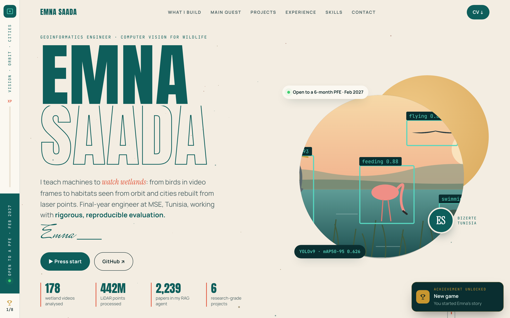

# emna-saada.github.io

Personal portfolio of **Emna Saada**: computer vision for wildlife monitoring, Earth observation, LiDAR and AI agents.

**Live: https://emna-saada.github.io/**



- The site at the root of this repository is the built output (served by GitHub Pages).
- The React source is in [`source/`](source/): React + Vite, GSAP, Lenis and React Bits.

## Update the site

```bash
cd source
npm install
npm run build
cp -r dist/. ..
```

Then commit and push; GitHub Pages republishes in about a minute.
